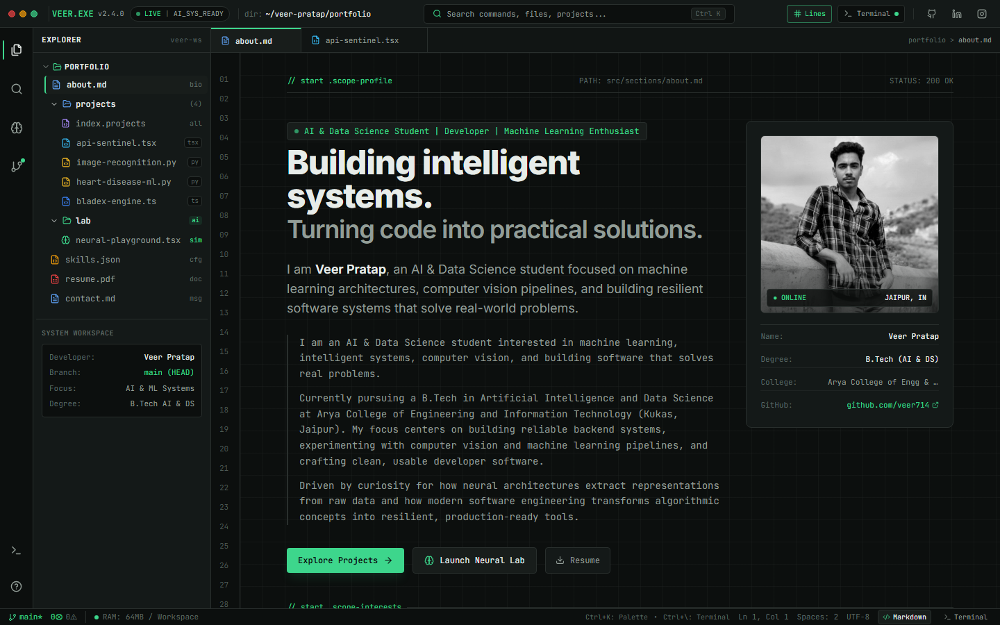

# VEER.EXE — AI & Data Science Developer Workspace

> A creative, high-performance developer portfolio and personal operating environment engineered for **Veer Pratap**, inspired by the code-editor aesthetics of Fine Thought and modern IDEs.



---

## 🚀 Concept & Design Philosophy

Rather than a generic landing page or conventional template, **VEER.EXE** is designed as **"An AI engineer's personal development environment"** — combining the technical feel of VS Code, a minimalist operating system, and an interactive machine learning workspace.

- **Theme Palette**: Dark stealth environment (`#0C0F0E`, `#141918`, `#181D1B`, `#292F2D`) with terminal lime accents (`#3DD68C`) and muted text (`#E7ECE9`, `#929D97`).
- **Typography**: Precision pairing of `Inter` for interface structure with `JetBrains Mono` for code, terminal diagnostics, and line gutter annotations.
- **Visual Grid**: Fine Thought-inspired syntax-comment architectural lines and editor gutters.

---

## 💻 Key Features

### 1. Application Shell
- **Top Application Bar**: System status pulse (`LIVE | AI_SYS_READY`), workspace path, command search launcher, line number toggle, and social profiles.
- **Left Sidebar & File Explorer**: Expandable folder tree (`PORTFOLIO/`, `projects/`, `lab/`, `skills.json`, `resume.pdf`, `contact.md`) with file type badges.
- **Tab Navigation**: Multi-tab workspace allowing users to open and switch between documents just like a real IDE.
- **Status Bar**: Live Git branch tracker (`main*`), system telemetry (`RAM: 64MB`), encoding, and shortcuts.

### 2. Interactive Terminal (`bash // veer@workstation`)
A fully functioning terminal drawer supporting keyboard navigation (Up/Down history) and commands:
- `help` — List all available commands
- `about` — Display developer summary and open `about.md`
- `projects` — Display projects and launch case studies
- `skills` — Output technical capability inventory
- `lab` — Launch the Neural Network & Computer Vision sandbox
- `open <file>` — Open any file in the workspace
- `cat <file>` — Print file contents directly to stdout
- `neofetch` / `whoami` / `date` / `clear`

### 3. VS Code-Style Command Palette (`Ctrl + K`)
Instant fuzzy finder to jump across files, case studies, actions, and external links with full keyboard navigation.

### 4. Neural Network & Computer Vision Sandbox (`lab/neural-playground.tsx`)
An interactive simulation demonstrating the mechanics of Veer's **CIFAR-10 Convolutional Neural Network**:
- Interactive 10-class selector
- Spatial kernel filters (`Sobel-H`, `Sobel-V`, `Laplacian`, `High-Pass`)
- Dynamic Conv2D feature map activation matrix
- Softmax probability logit distribution bars

### 5. Verified Projects
- **API Sentinel** (`api-sentinel.tsx`): API monitoring and security observability system. [GitHub](https://github.com/MindOverFloww/Sentinel-API) | [Live Demo](https://apisentinel-azure.vercel.app/)
- **CIFAR-10 Image Recognition** (`image-recognition.py`): Multi-class Computer Vision CNN. [GitHub](https://github.com/veer714/CIFAR_10)
- **Heart Disease Diagnostic ML** (`heart-disease-ml.py`): Supervised clinical risk modeling. [GitHub](https://github.com/veer714/)
- **BladeX Engine** (`bladex-engine.ts`): Developer script execution utility. [GitHub](https://github.com/veer714/bladex)

---

## ⌨️ Keyboard Shortcuts

| Shortcut | Action |
| :--- | :--- |
| `Ctrl / Cmd + K` | Open Command Palette |
| `Ctrl + \` or `Ctrl + \`` | Toggle Interactive Terminal |
| `Ctrl / Cmd + 1` | Open `about.md` |
| `Ctrl / Cmd + 2` | Open Projects Explorer |
| `Ctrl / Cmd + 3` | Open `skills.json` |
| `Ctrl / Cmd + 4` | Launch Neural Playground (`lab/`) |
| `Ctrl / Cmd + 5` | Open `contact.md` |
| `Escape` | Close active modals & drawers |

---

## 🛠️ Tech Stack

- **Framework**: React 18
- **Bundler**: Vite
- **Styling**: Tailwind CSS
- **Motion**: Framer Motion
- **Icons**: Lucide React
- **Fonts**: Inter & JetBrains Mono

---

## 📦 Getting Started Locally

```bash
# Install dependencies
npm install

# Start local development server
npm run dev

# Build for production
npm run build

# Preview production build
npm run preview
```

---

## 📸 Screenshots

Screenshots captured from the running application:
- Desktop Home: [`screenshots/desktop-home.png`](./screenshots/desktop-home.png)
- Projects Explorer: [`screenshots/desktop-projects.png`](./screenshots/desktop-projects.png)
- Project Detail: [`screenshots/project-detail.png`](./screenshots/project-detail.png)
- Skills Matrix: [`screenshots/desktop-skills.png`](./screenshots/desktop-skills.png)
- Interactive Terminal: [`screenshots/terminal.png`](./screenshots/terminal.png)
- Command Palette: [`screenshots/command-palette.png`](./screenshots/command-palette.png)
- Mobile View: [`screenshots/mobile-home.png`](./screenshots/mobile-home.png)
- Reference Screenshots: [`screenshots/reference/`](./screenshots/reference/)
